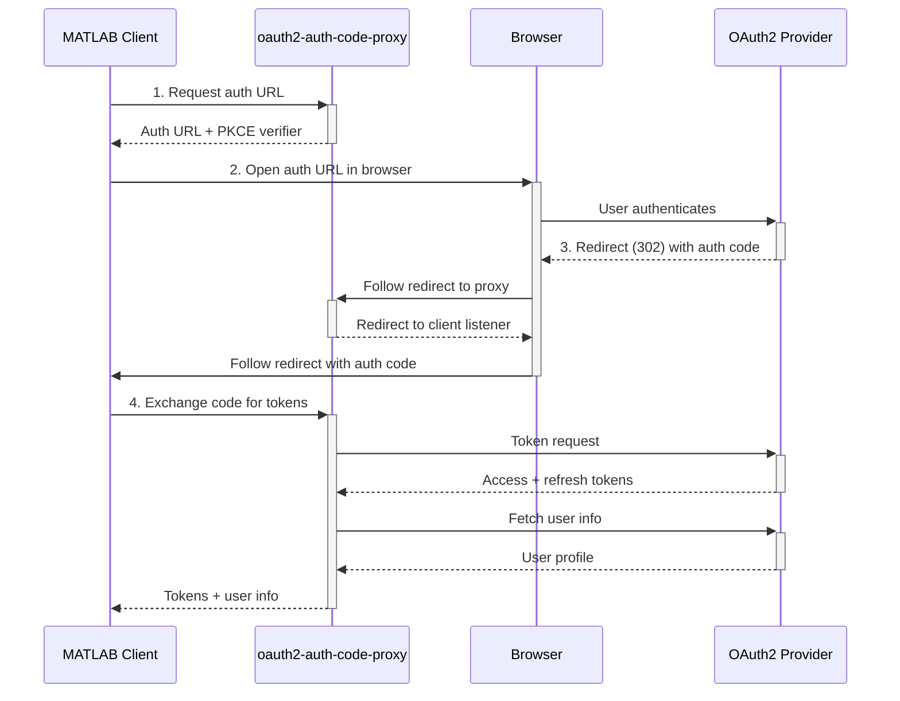

# OAuth2 Token Proxy

A lightweight OAuth2 token exchange proxy for MATLAB&reg; and other MathWorks&reg; desktop clients. It handles the server-side OAuth2 authorization code flow (with PKCE) so that desktop applications can authenticate users with third-party cloud providers without embedding client secrets locally.

## How It Works



1. Client requests an authorization URL from the proxy
2. User authenticates in the browser; provider redirects back to the proxy
3. Proxy exchanges the authorization code for tokens
4. Proxy returns tokens to the client

## Quick Start (Docker)

Pull and run the container image:

```bash
docker run -d \
  -p 30045:30045 \
  -v /path/to/creds.yaml:/etc/oauth2-auth-code-proxy/creds.yaml:ro \
  -e OAUTH_CREDS_FILE=/etc/oauth2-auth-code-proxy/creds.yaml \
  ghcr.io/mathworks-ref-arch/container-images/oauth2-auth-code-proxy:latest
```

The container listens on port 30045 by default (matching existing OAuth redirect URI configurations).

## Build

### Docker Image (recommended)

```bash
docker build -t oauth2-auth-code-proxy .
```

The Dockerfile is a self-contained multi-stage build: it compiles the Go binary from source and produces a minimal `scratch`-based image (~10 MB) containing only the static binary and CA certificates. It contains no credentials or TLS certificates — provide those at runtime via mounts and environment variables.

### Local Image with Your Own Credentials and Certs

For local testing, `Dockerfile.local` builds on top of the public image and bakes in your `creds.yaml` and TLS certificate, so the container runs without mounts or environment variables.

> **Warning:** this image contains your OAuth client secret and TLS private key. Never push or share it.

Place the files at the repo root (both paths are gitignored):

```
oauth2-auth-code-proxy/
├── creds.yaml        # OAuth app config (see Credentials File below)
└── certs/
    ├── tls.crt       # certificate (PEM)
    └── tls.key       # private key (PEM)
```

To use your own certificate, copy it in under exactly these names; its SANs must match the hostname clients connect to. If `certs/` is absent, `make docker-local` generates a self-signed certificate for `localhost` and `127.0.0.1`.

Build and run:

```bash
make docker-local

docker run -d --name oauth2-proxy -p 80:80 oauth2-auth-code-proxy-local:latest
```

Without `make`, build the public image first, then the local image on top of it:

```bash
docker build -t oauth2-auth-code-proxy:base .

docker build -f Dockerfile.local \
  --build-arg BASE_IMAGE=oauth2-auth-code-proxy:base \
  -t oauth2-auth-code-proxy-local:latest .
```

To skip compiling, set `BASE_IMAGE` to a published release instead, e.g. `ghcr.io/mathworks-ref-arch/container-images/oauth2-auth-code-proxy:<version>`.

To generate a self-signed certificate without `make` (in Git Bash, prefix the command with `MSYS_NO_PATHCONV=1`):

```bash
mkdir -p certs
openssl req -x509 -newkey ec -pkeyopt ec_paramgen_curve:prime256v1 \
  -keyout certs/tls.key -out certs/tls.crt -days 3650 -nodes \
  -subj "/CN=oauth2-auth-code-proxy" \
  -addext "subjectAltName=DNS:localhost,IP:127.0.0.1"
```

Rebuild the image whenever `creds.yaml` or the certificate changes.

### Standalone Binary

If you prefer to run the binary directly (without Docker), you need Go 1.22+ installed:

```bash
make build
```

This produces an `oauth2-auth-code-proxy` binary in the current directory with version metadata embedded. To cross-compile a static binary (e.g., for deployment on a Linux server from a Mac):

```bash
CGO_ENABLED=0 GOOS=linux GOARCH=amd64 make build
```

Run it directly:

```bash
./oauth2-auth-code-proxy --config /path/to/creds.yaml
```

| Flag | Description | Default |
|------|-------------|---------|
| `--config <path>` | Path to credentials YAML file | (required) |
| `--port <port>` | Listen port | `80` |
| `--mwlegacy-port <port>` | Enable legacy API listener on this port | (disabled) |
| `--tls-cert <path>` | TLS certificate for HTTPS serving | (none — serves HTTP) |
| `--tls-key <path>` | TLS private key for HTTPS serving | (none — serves HTTP) |
| `--tls-insecure-skip-verify` | Disable TLS certificate validation for outbound calls | `false` |

## Configuration

### Credentials File (required)

The service reads a YAML file defining your OAuth2 application. Mount it into the container:

```yaml
id: "100"
type: "sheets"
includeRefreshToken: true
cloudProvider: "google"
description: "Read Google Sheets"
descriptionCode: "google.sheets.read"
clientId: "<your-client-id>"
clientSecret: "<your-client-secret>"
redirectUri: "https://your-host/oauth/v1/redirect"
scopes:
  - "https://www.googleapis.com/auth/drive.readonly"
  - "email"
authUrl: "https://accounts.google.com/o/oauth2/auth"
tokenUrl: "https://oauth2.googleapis.com/token"
revokeUrl: "https://oauth2.googleapis.com/revoke"
host: "sheets.googleapis.com"
testingUrl: "https://openidconnect.googleapis.com/v1/userinfo"
nameKey: "name"
emailKey: "email"
idTokenNameKey: "name"
idTokenEmailKey: "email"
```

#### User Identity Keys

After a successful token exchange, the proxy calls `testingUrl` to verify the token works and retrieve the user's identity. The four key fields tell the proxy where to find the user's name and email in the provider's response:

| Key | Purpose |
|-----|---------|
| `testingUrl` | Endpoint the proxy calls with the new access token to verify it works and fetch user info. For Google, this is the OpenID Connect userinfo endpoint. |
| `nameKey` | JSON field name in the `testingUrl` response that contains the user's display name (e.g., `"name"` for Google, `"displayName"` for Microsoft). |
| `emailKey` | JSON field name in the `testingUrl` response that contains the user's email address (e.g., `"email"` for Google, `"mail"` for Microsoft). |
| `idTokenNameKey` | JSON field name in the decoded ID token (JWT) that contains the user's name. Used as a fallback if the userinfo endpoint doesn't return it. |
| `idTokenEmailKey` | JSON field name in the decoded ID token (JWT) that contains the user's email. Used as a fallback if the userinfo endpoint doesn't return it. |

#### The `email` Scope Requirement

The `scopes` list **must** include `"email"`. The proxy uses the email address as the primary user identifier returned to the client. Without the `email` scope, the OAuth provider won't include the email in its responses, and the proxy won't be able to identify who authenticated.

#### Configuring for a New OAuth Provider

To add a new provider, you need three URLs from its documentation:

1. **`authUrl`** — The authorization endpoint where users are sent to log in. Look for "OAuth 2.0 authorization endpoint" in the provider's docs.
2. **`tokenUrl`** — The token endpoint where authorization codes are exchanged for access tokens. Look for "token endpoint."
3. **`revokeUrl`** — The token revocation endpoint (optional but recommended). Look for "revoke token."

Then find the **userinfo endpoint** (`testingUrl`) and check what field names it returns. Most OpenID Connect providers use `name` and `email`, but some differ. You can test this manually:

```bash
curl -H "Authorization: Bearer <access-token>" https://provider.example.com/userinfo
```

The JSON response tells you what to put in `nameKey` and `emailKey`.

### Environment Variables

| Variable | Description | Default |
|----------|-------------|---------|
| `OAUTH_CREDS_FILE` | Path to credentials YAML inside container | (required) |
| `OAUTH_PORT` | Listen port | `80` |
| `OAUTH_MWLEGACY_PORT` | Enable legacy API listener on this port | (disabled) |
| `OAUTH_TLS_CERT_FILE` | TLS certificate for HTTPS serving | (none — serves HTTP) |
| `OAUTH_TLS_KEY_FILE` | TLS private key for HTTPS serving | (none — serves HTTP) |
| `OAUTH_TLS_INSECURE_SKIP_VERIFY` | Set `1` or `true` to skip TLS verify on outbound calls | `false` |

### Custom Redirect Page (optional)

The proxy serves an HTML page that redirects the browser back to the desktop client after OAuth2 callback. To customize this page, mount your own template:

```bash
-v /path/to/redirect.html:/etc/oauth2-auth-code-proxy/redirect.html:ro
```

The template receives a single `{{.URL}}` value — the redirect target URL.

## Docker Compose Example

```yaml
services:
  oauth2-proxy:
    image: ghcr.io/mathworks-ref-arch/container-images/oauth2-auth-code-proxy:latest
    ports:
      - "30045:30045"
    environment:
      OAUTH_CREDS_FILE: /etc/oauth2-auth-code-proxy/creds.yaml
    volumes:
      - ./creds.yaml:/etc/oauth2-auth-code-proxy/creds.yaml:ro
      # Optional: custom redirect page
      # - ./redirect.html:/etc/oauth2-auth-code-proxy/redirect.html:ro
```

## API

All v1 endpoints use a JSON envelope with a `mwtype` discriminator field.

### POST /oauth/v1/api

Single endpoint dispatching on `mwtype`:

| mwtype | Action |
|--------|--------|
| `oauth/InitRequest` | Generate authorization URL with PKCE |
| `oauth/TokenRequest` | Exchange authorization code for tokens |
| `oauth/RefreshRequest` | Refresh an expired access token |
| `oauth/ListRequest` | List configured apps (secrets excluded) |

### GET /oauth/v1/redirect

OAuth2 callback endpoint. Receives `code` and `state` from the provider and redirects the browser to the desktop client's local listener.

When the proxy generates an authorization URL (via `InitRequest`), it encodes the `state` parameter as `{appID}-{clientRedirectURL}`:

```
state=100-http%3A%2F%2Flocalhost%3A31515%3Fstate%3Dmatlabid
       ^^^  ^^^^^^^^^^^^^^^^^^^^^^^^^^^^^^^^^^^^^^^^^^^^^^^^^^^
       app   URL-encoded client redirect (where MATLAB is listening)
```

The full redirect URL sent to Google looks like:

```
https://accounts.google.com/o/oauth2/auth
  ?client_id=<your-client-id>
  &redirect_uri=https://your-host/oauth/v1/redirect
  &response_type=code
  &scope=email+https%3A%2F%2Fwww.googleapis.com%2Fauth%2Fdrive.readonly
  &state=100-http%3A%2F%2Flocalhost%3A31515%3Fstate%3Dmatlabid
  &code_challenge=<pkce-challenge>
  &code_challenge_method=S256
```

After the user authenticates, Google redirects the browser to:

```
https://your-host/oauth/v1/redirect?code=4/0ATx3LY...&state=100-http%3A%2F%2Flocalhost%3A31515%3Fstate%3Dmatlabid
```

The proxy splits `state` on the first `-` to extract:
1. **App ID** (`100`) — identifies which OAuth app config to use
2. **Client redirect URL** (`http://localhost:31515?state=matlabid`) — where to send the browser next

It then redirects the browser to the client's local listener with the original query parameters preserved:

```
http://localhost:31515?state=matlabid&code=4/0ATx3LY...&scope=email+drive.readonly
```

MATLAB's local HTTP server receives this request and has the auth code it needs to call `TokenRequest`.

### GET /oauth/v1/admin/alive[/{echo}]

Connectivity diagnostic endpoint. Returns version info and a per-URL connection report for every configured OAuth provider endpoint (`authUrl`, `tokenUrl`, `revokeUrl`, `testingUrl`).

Use this to verify the proxy can reach the provider from its network environment — especially useful when deploying behind a corporate proxy or firewall.

Example response (with proxy configured):

```json
{
  "echo": "test",
  "version": "1.0.0",
  "artifactId": "oauth2-auth-code-proxy",
  "buildTimestamp": "2026-05-29T14:00:00Z",
  "proxy": {
    "httpsProxy": "http://proxy.corp.example.com:8080",
    "noProxy": "10.0.0.0/8,localhost"
  },
  "connCheck": [
    {
      "url": "https://oauth2.googleapis.com",
      "viaProxy": true,
      "times": {
        "dnsLookup": "proxy",
        "tcpConnection": "proxy",
        "ping": "proxy",
        "tlsHandshake": "proxy",
        "httpResponseTime": "0.120s"
      },
      "status": {
        "success": true,
        "error": "",
        "lastChecked": "2026-05-29T14:00:01Z"
      }
    }
  ]
}
```

Each `connCheck` entry includes `viaProxy: true/false` indicating whether that specific URL was routed through the proxy. This is per-connection — `NO_PROXY` may cause some URLs to go direct while others go through the proxy.

When `viaProxy` is `true`, the DNS/TCP/TLS stages are handled by the proxy (reported as `"proxy"`) and only the overall HTTP response time is measured. When `viaProxy` is `false`, each network stage is timed individually.

A failed `connCheck` entry with a TCP timeout and `viaProxy: false` usually means the firewall is blocking direct access and the proxy environment variables need to be set.

The `{echo}` path parameter is optional — whatever string you pass is echoed back in the response, useful for correlating requests in logs.

#### Proxy Environment Variables

The proxy is configured via standard environment variables:

| Variable | Example | Purpose |
|----------|---------|---------|
| `HTTPS_PROXY` | `http://proxy.corp.example.com:8080` | Forward proxy for all outbound HTTPS traffic (OAuth provider calls) |
| `HTTP_PROXY` | `http://proxy.corp.example.com:8080` | Forward proxy for outbound HTTP traffic (rarely needed) |
| `NO_PROXY` | `10.0.0.0/8,.internal.corp,localhost` | Comma-separated list of hosts/CIDRs that bypass the proxy |

These are read by Go's standard library automatically. Set them in your container environment (Docker `-e`, Helm `proxy.*` values, or k8s `env` in the pod spec). The alive endpoint reports what's configured so you can verify without shell access.

**Example: running behind a corporate HTTP proxy**

```bash
docker run -d \
  -p 30045:30045 \
  -v /path/to/creds.yaml:/etc/oauth2-auth-code-proxy/creds.yaml:ro \
  -e OAUTH_CREDS_FILE=/etc/oauth2-auth-code-proxy/creds.yaml \
  -e HTTPS_PROXY=http://proxy.corp.example.com:8080 \
  -e HTTP_PROXY=http://proxy.corp.example.com:8080 \
  -e NO_PROXY=10.0.0.0/8,.internal.corp,localhost \
  ghcr.io/mathworks-ref-arch/container-images/oauth2-auth-code-proxy:latest
```

All outbound traffic to OAuth providers (Google, Microsoft, etc.) will route through the proxy. Internal traffic matching `NO_PROXY` patterns goes direct. Hit `/oauth/v1/admin/alive` after startup to confirm each provider URL shows `"viaProxy": true` and `"success": true`.

### GET /healthz

Liveness probe. Returns `200 ok` if the process is running.

### GET /readyz

Readiness probe. Returns `200 ok` once configuration is loaded and the service can handle traffic. Returns `503` during startup.

## Kubernetes

A Helm chart is provided in `deploy/helm/oauth2-auth-code-proxy/`. Install with:

```bash
helm install oauth2-proxy deploy/helm/oauth2-auth-code-proxy/ \
  --set credentials.existingSecret=my-oauth-creds
```

The chart configures startup, liveness, and readiness probes automatically. See `deploy/helm/oauth2-auth-code-proxy/values.yaml` for all options including proxy settings, autoscaling, and ingress.

## Development

All application source lives in the `internal/` package. The root `main.go` is a thin shell.

```bash
make build           # compile binary
make test            # tests with race detection
make lint            # golangci-lint v2
make cyclo           # cyclomatic complexity check (<10)
make swagger         # regenerate OpenAPI 3.1 spec
make mocks           # regenerate mockery mocks
make coverage-html   # generate coverage.html
make docker          # build container image locally
make docker-local    # local-only image with creds.yaml + certs/ baked in (never push)
make fmt             # format code
make clean           # remove build artifacts
```

## Example Usage

Please see the `matlab/example_script.m` file for an example script on how to use this service.

## License

This repository is licensed under the MathWorks Cloud Reference Architecture License. See [LICENSE.md](LICENSE.md) for full terms. Use of this software is permitted only in conjunction with MathWorks products and service offerings.

## Security

To report a vulnerability, please email security@mathworks.com. See [SECURITY.md](SECURITY.md) and the [MathWorks Vulnerability Disclosure Policy](https://www.mathworks.com/company/aboutus/policies_statements/vulnerability-disclosure-policy.html) for details.

---

Copyright 2020-2026 The MathWorks, Inc.
# oauth2-auth-code-proxy
